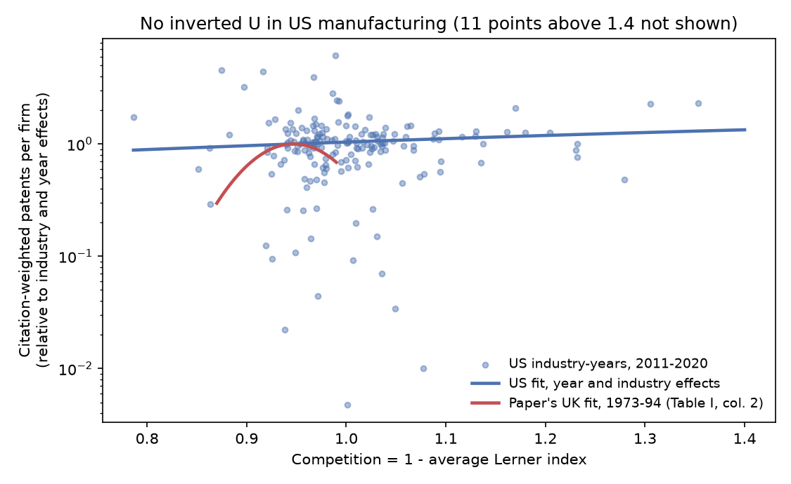
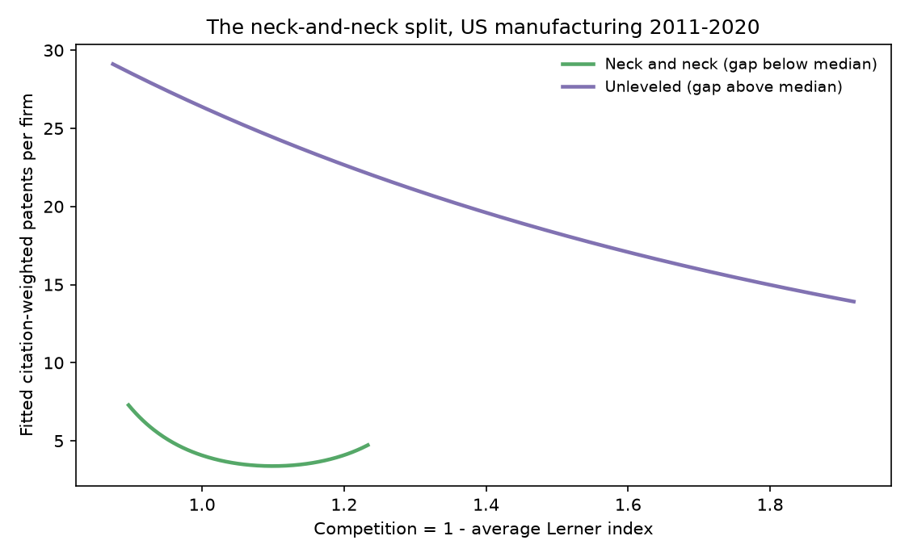

# How Much Competition Makes Firms Invent

### In 2005, Philippe Aghion and four colleagues found that innovation peaks when competition is neither too weak nor too strong. Twenty years later, I asked the question again with American patents.

---

In fiscal 2019 Apple sold $260 billion of phones, computers and services and kept about 23 cents of every dollar
as operating profit after paying for the factories and equipment behind them. Its engineers applied for 2,530 US
patents that year. Intel kept a similar 24 cents and applied for 2,417. Boeing, which sells airplanes to a market
it shares with essentially one rival, lost money in 2019 and still applied for 1,320. On the scale economists
use to measure how hard a company has to fight for its customers, Apple and Intel sit close together and Boeing
sits well away from both, yet all three spend heavily on new technology.

Whether fiercer competition makes companies invent more or less is one of the oldest questions in economics. One
side holds that a firm needs fat profits to pay for research and the prospect of more fat profits to make the
research worth doing, so monopoly is good for invention. The other holds that a comfortable firm has no reason to
change, and that the threat of losing customers is what forces it to improve. In 2005 a team of five economists
argued that both sides were right, at different points on the scale, and that the relationship between
competition and invention is shaped like an upside-down U.

---

## Two numbers for every industry

The paper measures competition with an accounting ratio that any annual report allows you to compute. For each
company, take operating profit, subtract a charge for the capital tied up in the business, and divide by sales.
This is the Lerner index, named after the economist Abba Lerner, and it measures how far price sits above cost.
The paper sets the capital charge at 8.5% of the capital stock, and I follow it, using net property, plant and
equipment as the capital stock. Competition in an industry is one minus the average Lerner index of its firms:

```math
l_{it} = \frac{\pi_{it} - 0.085\,K_{it}}{S_{it}}, \qquad c_{jt} = 1 - \frac{1}{N_{jt}} \sum_{i \in j} l_{it}
```

Here $`\pi_{it}`$ is firm $`i`$'s operating profit in year $`t`$, $`K_{it}`$ its net plant and equipment,
$`S_{it}`$ its sales, and $`N_{jt}`$ the number of listed firms in industry $`j`$. Apple's 2019 numbers, in
billions of dollars, give:

```math
l_{\text{Apple},2019} = \frac{63.93 - 0.085 \times 37.38}{260.17} = 0.234, \qquad 1 - l = 0.766
```

A value of 1 means price equals cost, the textbook picture of perfect competition. Values below 1 mean firms
earn a margin. Values above 1 mean the average firm in the industry is losing money, which the theory does not
contemplate but which, as it turns out, is common in American manufacturing.

| Firm or group | Lerner index | Competition, 1 − Lerner |
|---|---|---|
| Apple, fiscal 2019 | 0.234 | 0.766 |
| Typical UK industry in the paper, 1973–1994 (median) | about 0.05 | 0.95 |
| Boeing, fiscal 2019 | −0.040 | 1.040 |

Invention is measured with patents. Patents differ enormously in value, so each one is weighted by how often later
patents cite it, relative to the average patent filed the same year. A patent cited twice as often as its
cohort counts as two:

```math
w_p = \frac{\text{cites}_p}{\overline{\text{cites}}_{\,\text{year}(p)}}, \qquad y_{jt} = \frac{1}{N_{jt}} \sum_{i \in j} \sum_{p \in P_{it}} w_p
```

$`P_{it}`$ is the set of patents firm $`i`$ applied for in year $`t`$, and $`y_{jt}`$ is the industry's average
citation-weighted patent count per firm. Apple's 2,530 patents from 2019 count as 4,540, so the average Apple
patent from that year has been cited about 1.8 times as often as the average patent filed the same year. Across
the 200 firms in electronics (SIC 36) in 2019, the average was 72 citation-weighted patents per firm.

---

## The paper and its authors

The paper is "Competition and Innovation: An Inverted-U Relationship," published in the *Quarterly Journal of
Economics* in 2005 by Philippe Aghion, Nick Bloom, Richard Blundell, Rachel Griffith and Peter Howitt. At the time
Aghion was at Harvard and the Institute for Fiscal Studies, Bloom at the London School of Economics, Blundell and
Griffith at the Institute for Fiscal Studies and University College London, and Howitt at Brown. Aghion and
Howitt had built one of the standard models of growth through "creative destruction" in 1992, in which new firms
grow by replacing old ones. In October 2025 they shared half of the economics Nobel Prize for that theory, the
other half going to the economic historian Joel Mokyr.

The 2005 paper extends that line of work to firms that innovate step by step against a close rival. In each
industry two firms either sit level with each other or one is a step ahead. Competition does two things. Level,
or "neck-and-neck," firms earn little while they are tied, so tougher competition raises the reward for pulling
ahead, which the authors called the escape-competition effect. A laggard that is already a step behind earns
nothing, and tougher competition shrinks what it would earn by catching up, which is Schumpeter's old argument
that competition discourages invention. Which effect wins depends on how many industries are level, and that
share itself moves with competition. When competition is weak, most industries spend their time level and the
escape effect dominates. When competition is strong, most spend their time unlevel and the Schumpeterian effect
dominates.

The hump follows from the model's algebra. The paper assumes research costs rise with the square of research
intensity and, to get closed forms, sets the discount rate to zero (it reports that simulations with positive
discounting give the same results). Let $`x = n_0`$ be the research intensity of a level firm, which
rises with competition, let $`n_{-1}`$ be a laggard's intensity, $`h`$ the rate at which laggards copy for free,
and $`\pi_1`$ the leader's profit, and write $`B = h^2 + 2\pi_1`$. The paper's equilibrium conditions give
$`n_{-1} + h = \sqrt{x^2 + B} - x`$, and the aggregate flow of innovations is then:

```math
\begin{aligned}
I(x) &= \frac{4 n_0 (n_{-1} + h)}{2 n_0 + n_{-1} + h}
      = 4x \, \frac{\sqrt{x^2 + B} - x}{\sqrt{x^2 + B} + x} \\
I'(x) &= \frac{4B}{\left(\sqrt{x^2 + B} + x\right)^2}
         \left(1 - \frac{2x}{\sqrt{x^2 + B}}\right) \\
I'(\tilde{x}) &= 0 \iff \tilde{x}^2 + B = 4 \tilde{x}^2 \iff \tilde{x} = \sqrt{B/3}
\end{aligned}
```

The bracket in the second line falls as $`x`$ rises, so innovation climbs while competition is low, peaks at
$`\tilde{x}`$, and declines after it. The paper's second proposition adds that the hump appears only when $`\tilde{x}`$ lies
inside the range competition can reach.

The data came from 311 firms listed on the London Stock Exchange, in seventeen industries from 1973 to 1994,
matched to their US patents. The authors regressed citation-weighted patents on competition and its square,
with year and industry effects, and found a clear hump. Their preferred estimates (Table I, column 2) were 387.46
on competition and −204.55 on its square, which put the peak at a competition value of 0.947, right at the
median of their data, 0.95. They used Thatcher-era privatizations, the European Single Market and Monopolies and
Mergers Commission rulings as sources of variation in competition that were unlikely to have been driven by
innovation, and the hump survived.

The strongest objection came from Aamir Hashmi, who reran the test on publicly traded American manufacturers
and published it in the *Review of Economics and Statistics* in 2013. He found a mildly negative relationship,
with no hump, and argued that the two results fit the same model if British industries were more neck-and-neck
than American ones. Merger reviews now weigh effects on innovation as well as on
prices, and if the hump is real, the right answer depends on which side of it an industry sits.

---

## How I tested it

I built the paper's industry-year panel for the United States from two public sources. Company accounts come from
the SEC's Financial Statement Data Sets, which hold every number tagged in the financial statements of every
10-K, and I read all 58 quarterly files from 2012 to mid-2026. Patents come from the database of Kogan, Papanikolaou, Seru and
Stoffman, which links every US patent owned by a listed company to that company and records its filing date and
the citations it has received. Their link uses a licensed stock-market identifier, so I connected each
of their firms to its SEC filer by matching the patents' assignee names, cleaned by the USPTO's PatentsView
project, to every name the filer has used on a 10-K. A patent counts only if its own assignee name matches the
filer or one of its obvious subsidiaries. Of the patents in their data filed from 2011 to 2020, 624,478 were
attributed to an SEC filer and 437,235 were not, many of the latter belonging to foreign companies like Sony,
Canon and Toyota that do not file 10-Ks.

Wherever I could, I followed the paper's rules. Industries are two-digit SIC codes, which gives 20 manufacturing
industries against the paper's seventeen. Competition uses all listed firms in the industry, with the paper's
8.5% capital charge. Patents are dated by application year, and the citation weights are relative to the
patent's filing cohort. I kept US-headquartered manufacturers with at least $10 million of revenue, from 2011 to
2020 (later filing years are not yet fully granted), and required five firms for an industry-year. That leaves
13,583 firm-years and 200 industry-years with a median of 24 firms each. The estimating equation is the paper's:

```math
\begin{aligned}
y_{jt} &= \exp\left(\beta_1 c_{jt} + \beta_2 c_{jt}^2 + \alpha_j + \tau_t\right) u_{jt},
\qquad \mathbb{E}\left[u_{jt} \mid c_{jt}, \alpha_j, \tau_t\right] = 1 \\
c^{*} &= -\frac{\beta_1}{2\beta_2}
\end{aligned}
```

Here $`\alpha_j`$ are industry effects, $`\tau_t`$ year effects, $`u_{jt}`$ a multiplicative error and
$`c^{*}`$ the peak. I estimate it by Poisson
quasi-maximum likelihood with standard errors clustered by industry, which allows each industry's errors to be
correlated over time. A significant negative $`\beta_2`$ is not enough to show a hump, because the peak might lie
outside the data, so I also use the test of Lind and Mehlum (2010), which asks whether the slope is positive at
the lowest competition observed and negative at the highest:

```math
H_0:\ \beta_1 + 2\beta_2 c_{\min} \le 0 \ \ \text{or} \ \ \beta_1 + 2\beta_2 c_{\max} \ge 0
```

The paper's policy instruments are British, and I have no American equivalent, so these estimates show
association, as the paper's column 2 does.

---

## Within American industries, the hump disappears

With year and industry effects, which is the paper's preferred specification, competition and invention are
unrelated in US manufacturing from 2011 to 2020:

```math
\begin{aligned}
\text{US, 2011–2020:}\quad & \hat{\beta}_1 = 1.19\ (3.11), \quad \hat{\beta}_2 = -0.23\ (1.14), \quad N = 200 \\
& \chi^2_2 = 0.33,\ p = 0.85; \quad \text{Lind–Mehlum } p = 0.54 \\
\text{UK, 1973–1994:}\quad & \hat{\beta}_1 = 387.46\ (67.74), \quad \hat{\beta}_2 = -204.55\ (36.17), \quad N = 354
\end{aligned}
```

The American coefficients are tiny next to the British ones and indistinguishable from zero, and a
straight-line version gives a slope of 0.56 with a standard error of 1.14.
Splitting industry-years into fifths by competition, and letting the data draw any shape it likes, tells the same
story.

| Competition quintile | Range of 1 − Lerner | Patents relative to the least competitive fifth |
|---|---|---|
| Least competitive | 0.786 to 0.954 | 1.00 |
| Second | 0.955 to 0.975 | 1.04 |
| Middle | 0.975 to 1.009 | 1.05 |
| Fourth | 1.009 to 1.059 | 1.03 |
| Most competitive | 1.061 to 2.070 | 1.06 |



The figure removes industry and year effects and plots what is left against competition. The red curve is the paper's British estimate over the range of its data, and the blue line is the
American fit. Over the stretch where the British curve rises and falls back, American industries show no pattern
at all.

---

## Comparing across industries brings the hump back, for the wrong reason

Drop the industry effects and an inverted U reappears. The fit peaks at a competition value of 1.35, with a 95%
interval from 1.26 to 1.44, and it passes the Lind–Mehlum test (p = 0.024). But 94% of industry-years sit on the
rising side of the peak, and the shape comes from comparing industries that differ in many ways, not from any
industry becoming more or less competitive.

| Industry | Top patentees, 2011–2020 | Firms a year | Average Lerner | Firms losing money | Weighted patents per firm |
|---|---|---|---|---|---|
| Machinery and computers | IBM, Apple, HP | 161 | −2.2% | 31% | 77.2 |
| Transportation equipment | Ford, Boeing, General Motors | 86 | 0.6% | 17% | 46.7 |
| Electronics | Intel, Qualcomm, General Electric | 225 | −3.1% | 37% | 44.7 |
| Instruments and medical devices | 3M, Boston Scientific, Raytheon | 208 | −14.7% | 43% | 41.5 |
| Petroleum refining | Chevron, ExxonMobil, ConocoPhillips | 17 | −2.8% | 22% | 13.0 |
| Chemicals and drugs | Procter & Gamble, Merck, Monsanto | 305 | −67.1% | 48% | 8.2 |
| Food | Coca-Cola, PepsiCo, General Mills | 77 | 3.2% | 20% | 0.6 |
| Lumber and wood | Louisiana-Pacific, Jeld-Wen, Trex | 16 | 4.4% | 14% | 0.2 |

The industries that patent most, computers, electronics, vehicles and instruments, have average margins near or
below zero and competition values close to or above 1. Food, lumber, apparel and leather earn steady 3% to 5% margins and patent
almost nothing. Chemicals and drugs combine deep average losses with modest patenting per firm. Line those up and
you get a hump, but it is a hump in industry type, and the paper's industry effects exist to remove exactly this
kind of permanent difference.

---

## A third of listed manufacturers lose money, and that strains the measure

The Lerner index was meant to capture margins over cost, and in the paper's British sample it averaged 4%. Among
American listed manufacturers from 2011 to 2020 the median firm-year earned 3.5%, but the mean was −18.2%,
because 33.7% of firm-years showed an operating loss. In chemicals and drugs, which includes drug and
biotechnology developers whose sales clear the $10 million bar while their research spending runs far higher,
the average Lerner index was −67.1% and 48% of firm-years showed operating losses. The industry's competition value rose from 1.31 in
2011 to 2.07 in 2018, and a change that size in an industry of about 300 listed firms reflects who is listed
more than how fiercely anyone competes.

None of several other versions of the measure produces an inverted U within industries.

| Version of the test | Shape of the fitted curve | Joint p, both terms | Lind–Mehlum p |
|---|---|---|---|
| Paper's definitions (preferred) | rises slightly, peak beyond the data | 0.85 | 0.54 |
| No capital charge | rises slightly, peak beyond the data | 0.84 | 0.50 |
| Median instead of mean Lerner index | shallow U | 0.17 | 0.96 |
| Profitable firms only | shallow U | 0.73 | 0.73 |
| Revenue of $100 million or more | shallow U | 0.43 | 0.86 |
| Excluding drug makers (SIC 283) | shallow U | 0.15 | 0.97 |
| Three-digit industries (604 industry-years) | falls slightly, low point beyond the data | 0.10 | 0.87 |
| Sales-weighted Lerner index | U, lowest at 0.945 | < 0.001 | 1.00 |
| Patents not weighted by citations | falls as competition rises | < 0.001 | 0.67 |

Counted without citation weights, patents fall as competition rises, and the
decline is significant at the competitive end of the range, which is close to Hashmi's "mildly negative"
American result. The sales-weighted version, which lets big firms dominate the average, gives a significant
curve that bends the other way, with innovation lowest near a competition value of 0.945, almost exactly where
the British data put the peak.

---

## The neck-and-neck test points the other way

The model makes two further predictions, and Hashmi's reconciliation rests on them. Industries should become
less neck-and-neck as competition rises, and the hump should be steeper where firms are close to one another. The
paper measured closeness as each firm's distance from the industry's most productive firm, and I build the same
gap from revenue relative to a cost-weighted index of operating costs and capital:

```math
m_{jt} = \frac{1}{N_{jt}} \sum_{i \in j} \frac{A_{Ft} - A_{it}}{A_{Ft}}, \qquad A_{it} = \frac{S_{it}}{V_{it}^{\,s_{jt}}\,(0.085\,K_{it})^{1 - s_{jt}}}
```

$`V_{it}`$ is operating cost, $`s_{jt}`$ the industry's median cost share and $`F`$ the most productive firm. The
first prediction holds across industries. Regressed on competition with year effects, the gap rises by 0.34
(standard error 0.06) per unit of competition, and with industry effects the slope is 0.07 (0.06), positive but
not significant. When the frontier is set at the 90th-percentile firm instead of the single best one, the
within-industry slope is 0.12 (0.03).

The second prediction fails. Interacting competition and its square with the gap gives jointly significant terms
whose signs are the opposite of what the model predicts:

```math
\hat{\beta}_{c \times m} = 12.31\ (2.98), \quad \hat{\beta}_{c^2 \times m} = -11.43\ (2.71), \quad \chi^2_2 = 17.8
```

The implied coefficient on competition squared is 7.86 at the 25th percentile of the gap and 5.13 at the 75th,
positive at both, so the curve is a U that flattens as industries become less neck-and-neck. Fitting the two
halves separately, the neck-and-neck half shows a U with its low point at 1.10, and the unlevel half a decline
that is not statistically significant. The model predicts the reverse. The paper's own interaction terms in
Table III, column 4, have the same signs, 3.82 on competition times the gap and −3.84 on its square, each small
next to its main term. The paper read the prediction off the split-sample curves in its Figure III and cited the
joint significance of these terms as confirmation.



I would not lean hard on this. The gap rises mechanically with the number of firms in an industry, because the
best of many firms is further from the average than the best of a few, and its correlation with firm counts is
0.78. With the 90th-percentile frontier, which weakens that link, the neck-and-neck half shows a hump-shaped point
estimate peaking at 0.99, but with a standard error so large that the Lind–Mehlum p-value is 0.35.

---

## Why it matters

For consumers, the hope that a dose of competition will bring both lower prices and more new products is not
contradicted by this data, but it is not supported either. Among American manufacturers in the 2010s, industries
that became more or less competitive did not change how much they invented.

For workers in research and engineering, whose jobs follow patenting, the industries that patent most are not
the comfortable, high-margin ones the Schumpeterian side of the argument has in mind. In computers, electronics
and medical instruments, between 31% and 43% of listed firm-years showed operating losses, so much of the
research is done by firms spending ahead of their revenue.

For smaller firms, the result cuts against the argument that more rivals would spur everyone to invent. The
companies that dominate patenting here, IBM, Intel, Apple, Qualcomm and Ford, sit in industries whose average
margins are near or below zero, and the differences in invention lie between industries, not within them.

For policy, the 2023 Merger Guidelines ask the agencies to consider how a merger affects innovation, not only
prices. The inverted U suggests a rule of thumb, that mergers in very competitive industries could help
invention and mergers in concentrated ones could hurt it. The American data from 2011 to 2020 do not place
industries on either side of a peak, so innovation arguments in merger cases need evidence about the particular
industry rather than a position on a curve.

---

## Limits of this study

Accounting margins mix market power with the life cycle of a firm, and in an economy where many listed
manufacturers lose money for years while developing products, the Lerner index is a weaker measure of competition
than it was for British firms in the 1970s and 1980s. The patent match misses subsidiaries whose names share
nothing with the parent's, leaves out private companies entirely, and relies on the original database's links,
some of which are wrong (I excluded the errors I found). SIC codes put a firm in one industry even when it sells
in several, and listed-firm margins ignore imports, which in many manufacturing industries supply a large share of what
Americans buy. Ten years of within-industry variation is less than the paper's 22, and the competition measure
moves little within most industries, so a modest hump could exist and go undetected. Without an instrument, none
of these estimates shows that competition causes anything, in either direction.

---

## Further reading

- [TECHNICAL.md](TECHNICAL.md) has the data files, rules, full test statistics and how to reproduce the results.
- [results/FINDINGS.md](results/FINDINGS.md) has a plain-English summary and every table the scripts produce.
- [METHODS_REVIEW.md](METHODS_REVIEW.md) is a methods and reporting review of the original paper.
- The original paper is Philippe Aghion, Nick Bloom, Richard Blundell, Rachel Griffith and Peter Howitt,
  "Competition and Innovation: An Inverted-U Relationship," *Quarterly Journal of Economics* 120(2), 2005,
  pp. 701–728.
- Aamir Hashmi, "Competition and Innovation: The Inverted-U Relationship Revisited," *Review of Economics and
  Statistics* 95(5), 2013, pp. 1653–1668.
- Carl Shapiro, "Competition and Innovation: Did Arrow Hit the Bull's Eye?" in Josh Lerner and Scott Stern (eds.),
  *The Rate and Direction of Inventive Activity Revisited*, University of Chicago Press, 2012.
- Jo Thori Lind and Halvor Mehlum, "With or Without U? The Appropriate Test for a U-Shaped Relationship," *Oxford
  Bulletin of Economics and Statistics* 72(1), 2010.
- Data come from the SEC [Financial Statement Data Sets](https://www.sec.gov/dera/data/financial-statement-data-sets);
  Kogan, Papanikolaou, Seru and Stoffman
  [patent data, extended to 2025](https://github.com/KPSS2017/Technological-Innovation-Resource-Allocation-and-Growth-Extended-Data);
  USPTO PatentsView disambiguated assignees, release of December 31, 2024
  ([Zenodo mirror](https://zenodo.org/records/15783125)).

*Brendyn Beasley*
